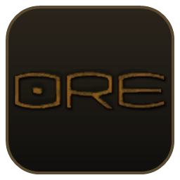
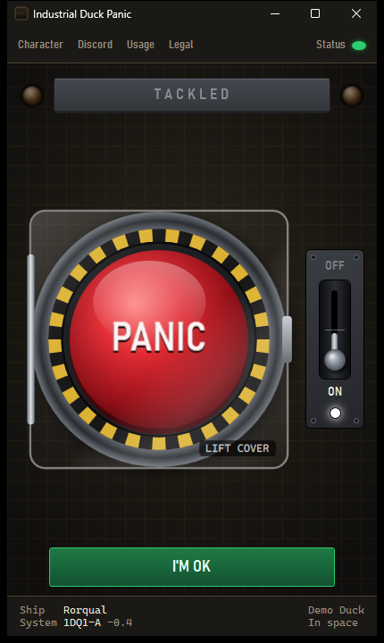
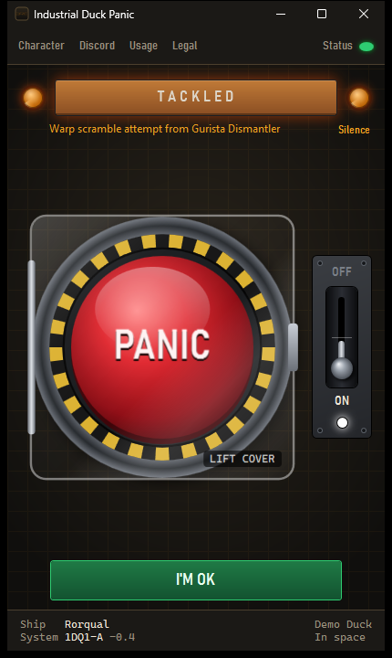
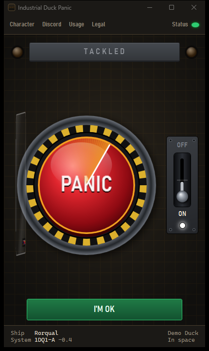

<p align="center">
  
</p>

<h1 align="center">Industrial Duck Panic</h1>

<p align="center">
  Discord alerts for EVE Online industrial pilots flying a Porpoise, an Orca or a Rorqual.<br>
  Get tackled, hit PANIC, lose your ship: your corp or alliance knows within seconds.
</p>

<p align="center">
  <a href="https://github.com/ComFatal/rorqual-panic/releases/latest"><b>⬇ Download the latest version</b></a>
  &nbsp;·&nbsp; Windows 10 / 11 (64-bit)
  &nbsp;·&nbsp; <a href="#français">Français</a>
</p>

<p align="center">
  
  
  
</p>

## What it does

| | |
|---|---|
| **TACKLED** | The bar blinks orange and the beacons spin when a warp scrambler or disruptor lands on you. One Discord message is sent per tackle. |
| **PANIC** | Rorqual only. Lift the glass cover, press the big red button, and Discord is warned. |
| **Ship lost** | When your industrial ship turns into a capsule in space, a message is sent automatically. |
| **I'M OK** | Tells Discord you are alive and safe, and turns the alerts off. |
| **ON / OFF switch** | Moves by itself: OFF when docked, ON in space, middle when the state is unknown. |
| **Status** | Shows at a glance if EVE, Discord and the game logs are working, plus your ship and system. |

The app only works in an Industrial Command Ship or a Capital Industrial Ship (Porpoise, Orca, Rorqual and their variants). The list comes live from EVE, so a new hull is picked up automatically.

## Install

1. Open the [latest release](https://github.com/ComFatal/rorqual-panic/releases/latest) and download **`IndustrialDuckPanic-win-Setup.exe`**.
2. Run it. The app installs for your Windows account only (no admin rights needed) and starts.
3. Windows may show *"Windows protected your PC"*, because the app is not code-signed. Click **More info → Run anyway**.

Prefer not to install? Download **`IndustrialDuckPanic-win-Portable.zip`**, unzip it anywhere and run `Industrial Duck Panic.exe`.

**Updates:** Status → *Check for updates* downloads and installs the new version (installed version only).

**Uninstall:** Windows Settings → Apps → Industrial Duck Panic.

## Getting started

### 1. Connect your character

Click **LOG IN with EVE ONLINE**. The official EVE login page opens in your browser; the app never sees your password. It asks for three read-only rights and nothing else:

- `esi-location.read_location.v1`: your solar system, docked or not
- `esi-location.read_ship_type.v1`: the ship you fly
- `esi-location.read_online.v1`: whether you are logged in

Nothing else in the app works until a character is connected.

### 2. Set up Discord

**If you run the Discord channel** (corp or alliance leader):

1. In Discord: channel settings → **Integrations → Webhooks → New Webhook → Copy Webhook URL**.
2. In the app: **Discord** tab → paste the URL, adjust the messages and the ping (@here, @everyone, a role or none), choose your corporation or alliance.
3. Click **SAVE**. This creates an **`IDP.config`** file. Share it with your members (a pinned message works well).

**If you are a member:** **Discord** tab → **Load configuration** → pick the `IDP.config` file you were given. The app checks that your character belongs to the right corporation or alliance.

Click **Send test message** to check that everything works.

Messages can use `%personnage_name%`, `%system%`, `%ship%` and `%attacker%` (tackle only).

## Good to know

- **Tackle detection reads the game logs** in `Documents\EVE\logs\Gamelogs` and needs the game client in **English**. If your logs are elsewhere (OneDrive, other drive), change the folder in Status.
- **The app never touches the game.** It does not press keys, click, type in chat, read the game's memory or automate anything. PANIC in the app warns Discord; it does **not** activate the module in game, do that yourself.
- **One character at a time.** Built for the solo miner who multiboxes miners with one booster.
- **The webhook URL is encrypted** inside `IDP.config`: members can use it from the app but cannot read it, and editing the file by hand breaks it. This stops casual copying, not a determined reverse engineer.
- **Your data stays on your PC.** The EVE token is stored encrypted for your Windows account. Your character name, ship and system go only to the Discord webhook of your configuration. Nothing is sent to the authors.

## Troubleshooting

| Problem | Fix |
|---|---|
| Login says port 8642 is in use | Close the program using that port and try again. |
| TACKLED never lights up | Status → *Game logs* must be green. Check the log folder and that the game is in English. Use *Test the TACKLED light* to check the display. |
| Discord dot is red | Status shows why: no configuration loaded, webhook deleted in Discord, or a configuration made for another corporation/alliance. |
| "ERROR, NOT IN ALLOWED SHIP LIST" | You are not in a Porpoise, Orca or Rorqual. Alerts are off in other ships. |
| The app crashed | Details are in `%AppData%\IndustrialDuckPanic\crash.log`. Please attach it to an [issue](https://github.com/ComFatal/rorqual-panic/issues). |

To remove access from the EVE side: [EVE third-party applications](https://community.eveonline.com/support/third-party-applications/).

---

## Français

**Industrial Duck Panic** envoie des alertes Discord pour les pilotes de Porpoise, Orca et Rorqual : tackle, PANIC, vaisseau détruit et « I'm OK ».

1. **Installer :** téléchargez `IndustrialDuckPanic-win-Setup.exe` dans la [dernière version](https://github.com/ComFatal/rorqual-panic/releases/latest). Si Windows affiche « Windows a protégé votre ordinateur », cliquez **Informations complémentaires → Exécuter quand même** (l'application n'est pas signée).
2. **Connecter le personnage :** bouton **LOG IN with EVE ONLINE**. Seuls trois droits en lecture sont demandés : position, type de vaisseau, en ligne ou non.
3. **Discord :**
   - **Responsable :** créez un webhook Discord, collez-le dans l'onglet Discord, puis **SAVE**. Partagez le fichier `IDP.config` obtenu.
   - **Membre :** Discord → **Load configuration** → choisissez le `IDP.config` reçu.

La détection du tackle lit les gamelogs du jeu, avec le client en anglais. L'application n'agit jamais dans le jeu : le bouton PANIC prévient Discord mais n'active pas le module.

---

## Building from source

Requires the [.NET 10 SDK](https://dotnet.microsoft.com/download).

```powershell
dotnet test tests/IndustrialDuckPanic.Tests                          # unit tests (+ live ESI tests)
dotnet run --project src/IndustrialDuckPanic                         # run the app
dotnet run --project src/IndustrialDuckPanic -- --demo tackled       # offline demo, no account needed
```

Demo scenarios: `rorqual`, `tackled`, `panic`, `wrong`, `docked`, `lost`, `error`. Add `--panel status` (or `discord`, `usage`, `legal`, `character`) to open a panel.

| Folder | Content |
|---|---|
| `src/IndustrialDuckPanic.Core` | EVE SSO (PKCE), ESI client, gamelog reader, Discord webhook, encrypted `IDP.config` |
| `src/IndustrialDuckPanic` | WPF app (ORE theme) |
| `tests/IndustrialDuckPanic.Tests` | xUnit tests (`Category=Live` calls the real ESI and Discord) |

### Publishing a release

```powershell
powershell -ExecutionPolicy Bypass -File .\build-release.ps1 -Version 0.2.0
```

Then create a GitHub release tagged `v0.2.0` and upload **every file** from `Releases\`: the `Setup.exe` and `Portable.zip` for players, plus `*.nupkg`, `releases.win.json`, `assets.win.json` and `RELEASES`, which the in-app updater needs.

The EVE application settings (client ID, callback `http://localhost:8642/callback`, scopes) are in `src/IndustrialDuckPanic.Core/AppConstants.cs`.

## Legal

EVE Online and the EVE logo are the registered trademarks of Fenris Creations (formerly CCP Games). All rights are reserved worldwide. EVE Online, the EVE logo, EVE and all associated logos and designs, including the ORE logo and ship names, are the intellectual property of Fenris Creations. Fenris Creations does not endorse and is not affiliated with Industrial Duck Panic, and is in no way responsible for the content or functioning of this application.

Industrial Duck Panic is a free, unofficial tool provided "as is", without warranty of any kind. Use at your own risk.
